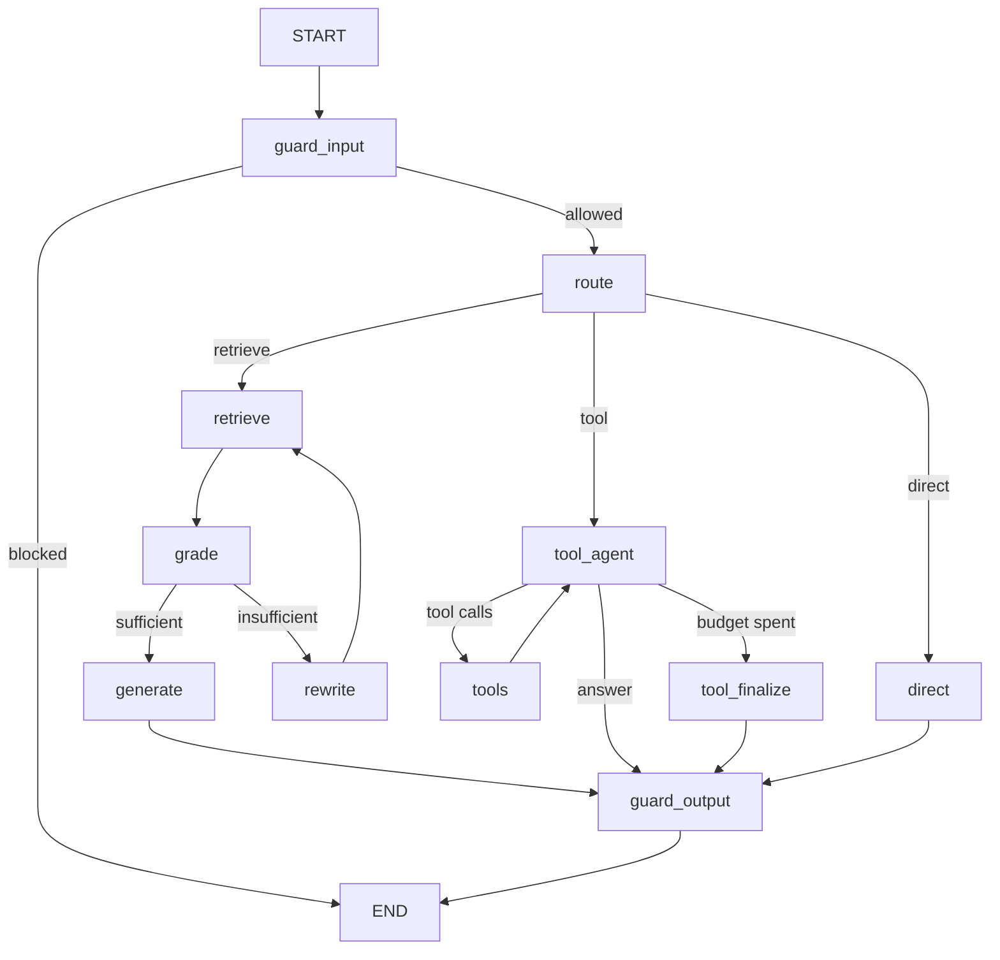

# Enterprise Document Agent

A retrieval-augmented agent that answers questions from enterprise policy
documents **and** performs actions, with every claim traced back to a source.

It is built to be honest rather than impressive: answers carry inline
citations, unverifiable answers are downgraded to an explicit
"I don't have enough information", and every action is validated against
policy before it runs.

```
Question
   │
   ▼
┌──────────────┐   blocked   ┌──────────┐
│ Input guard  ├────────────►│ Refusal  │
└──────┬───────┘             └──────────┘
       │ allowed (PII redacted)
       ▼
┌──────────────┐   tool      ┌────────────────────────────┐
│ Router (LLM) ├────────────►│ Tool agent ⇄ MCP server    │
└──────┬───────┘             │ (tickets, expenses, ...)   │
       │ retrieve            └──────────────┬─────────────┘
       ▼                                    │
┌────────────────────────┐                  │
│ Hybrid retrieval       │                  │
│  BM25 + dense → RRF    │                  │
└──────────┬─────────────┘                  │
           ▼                                │
┌────────────────────────┐                  │
│ Grade evidence (LLM)   │                  │
│   insufficient → rewrite│                 │
└──────────┬─────────────┘                  │
           ▼                                │
┌────────────────────────┐                  │
│ Answer with citations  │◄─────────────────┘
└──────────┬─────────────┘
           ▼
┌───────────────────────────────────┐
│ Output guard: citations resolve,  │
│ sentences grounded, PII redacted  │
└──────────┬────────────────────────┘
           ▼
    Answer + Sources + confidence
```

---

## 1. What is implemented

| Requirement | Where | Notes |
|---|---|---|
| RAG over enterprise documents | `rag/` | heading-aware chunking, persisted index |
| **Hybrid search** | `rag/bm25.py`, `rag/retriever.py` | BM25 (from scratch) + dense vectors fused with weighted RRF |
| **Source-grounded responses** | `agent/prompts.py`, `guardrails/output_guard.py` | mandatory `[n]` citations, sentence-level grounding score, abstain instead of guess |
| **Tool calling / actions** | `tools/`, `mcp/` | 6 tools, pydantic-validated, audited, idempotent |
| **MCP-based tools** | `mcp/server.py`, `mcp/client.py` | stdio MCP server + sync client adapter, with in-process fallback |
| **Stateful workflows (LangGraph)** | `agent/graph.py`, `agent/state.py` | 11 nodes, conditional edges, bounded loops, per-thread checkpointer |
| **Guardrails** | `guardrails/` | prompt injection, data exfiltration, PII in/out, citation + grounding checks |
| **LLM evaluation** | `evaluation/` | retrieval metrics (hit@k, recall@k, MRR, nDCG) + LLM-as-a-judge |
| **Groq API** | `llm/groq_client.py` | `llama-3.3-70b-versatile` primary, `llama-3.1-8b-instant` for routing |
| **Runs without a key** | `llm/offline.py` | deterministic extractive model so tests/CI/demo work offline |

---

## 2. Quickstart

```bash
# 1. Environment
python -m venv .venv
.venv\Scripts\activate          # Windows
# source .venv/bin/activate     # macOS / Linux
pip install -r requirements.txt

# 2. API key  →  open .env and set GROQ_API_KEY=gsk_...
#    (the .env file already exists with every other default pre-filled)

# 3. Build the retrieval index
python run.py ingest

# 4. Ask something
python run.py ask "What are the hotel caps for domestic and international travel?"
```

If `GROQ_API_KEY` is empty the agent **still runs** in offline mode: retrieval,
tools, guardrails and the graph are unchanged, only text generation uses a
deterministic extractive model instead of Groq. That is what the test suite uses.

### Example session

Real output from the bundled knowledge base (offline mode; with a Groq key the
answer is written by `llama-3.3-70b-versatile` instead of quoted verbatim):

```bash
$ python run.py ask "How long are application logs retained?" --explain

Retrieval breakdown
  1. data_retention_policy::0003 score=0.0164 bm25=13.06@1 dense=0.29@1
     data_retention_policy.md - Application and Security Logs
  2. data_retention_policy::0004 score=0.0157 bm25=3.60@4 dense=0.12@3
     data_retention_policy.md - Backup Retention
  3. data_retention_policy::0001 score=0.0156 bm25=2.97@6 dense=0.13@2
     data_retention_policy.md - Purpose and Scope

=====================================================================================
Q: How long are application logs retained?
mode=offline  route=retrieve  0.02s  confidence=1.00
-------------------------------------------------------------------------------------
According to [1] (data_retention_policy.md - Application and Security Logs):
Application logs are retained for 90 days and are used for debugging, performance
analysis, and product improvement. Security logs are retained for 13 months so that
a full annual review cycle can be investigated.

Sources
  * [1] data_retention_policy.md - Application and Security Logs

guard=pass  grounding=1.00  issues=none
trace: input_guard:allow(risk=0.00) -> route:retrieve(...) -> retrieve:6 hits(...)
       -> grade:sufficient(0.75) -> generate:372 chars -> guard_output:pass(grounding=1.00, citations=1)
```

Note the two retrievers agreeing on the top hit (`bm25@1`, `dense@1`) - when they
disagree, RRF is what keeps the answer stable.

### Multi-turn chat

```bash
python run.py chat
you> What is the password rotation interval?
you> What is the minimum length?          # remembers the thread
you> /history                              # inspect stored turns
you> /new                                  # start a fresh LangGraph thread
```

---

## 3. CLI reference

| Command | Purpose |
|---|---|
| `python run.py ingest [--force]` | build/rebuild the hybrid index |
| `python run.py ask "<question>" [--explain] [--json] [--thread ID]` | one question |
| `python run.py chat [--thread ID]` | interactive session with memory |
| `python run.py evaluate [--retrieval-only] [--limit N] [--no-judge]` | run the golden set |
| `python run.py tools [--probe-mcp]` | list tools, or verify the MCP server |
| `python run.py graph` | print the LangGraph topology as Mermaid |
| `python run.py info` | effective configuration + index stats |

---

## 4. How retrieval works

1. **Load** (`rag/loaders.py`) — Markdown/TXT (PDF via optional `pypdf`), title
   taken from the H1.
2. **Chunk** (`rag/chunking.py`) — split on `##`/`###` headings first, then a
   120-word sliding window with 25-word overlap inside each section. The
   heading path becomes the citation label (`travel_expense_policy.md -
   Accommodation`). Chunk ids are document-global and contiguous, which is what
   makes neighbour expansion work.
3. **Score text** (`rag/embeddings.py::embedding_text`) — embeddings and BM25 see
   `title - section. body`, so a chunk containing only "180" still matches
   "hotel cap". Citations stay clean.
4. **Index** (`rag/indexer.py`) — chunks + vectors persisted under `data/index/`
   with a manifest that hashes every source file. Editing a policy makes the
   index stale, and `build()` rebuilds it automatically. Changing
   `EMBEDDING_BACKEND` makes `load()` refuse to pair new queries with old vectors.
5. **Search** (`rag/retriever.py`)

   ```
   BM25 top-N  ─┐
                ├─► weighted RRF ─► neighbour expansion ─► near-duplicate removal ─► top-k
   dense top-N ─┘
   ```

   RRF is used instead of adding scores because BM25 scores are unbounded and
   cosine similarities are not — ranks need no calibration:

   `score(d) = Σ wᵢ / (k + rankᵢ(d))`, `k = 60`.

**Why this raises retrieval accuracy**

- lexical + semantic failures are *different* failures, so fusion fixes the
  union of them;
- heading-aware chunks keep one policy rule per chunk, so a hit is citable;
- overlap prevents boundary sentences from becoming unfindable;
- near-duplicate suppression stops one fact from eating three context slots;
- neighbour expansion gives the LLM readable context without polluting the
  citation.

### Embedding backend

Groq serves chat completions, not embeddings, so the dense side is local:

| `EMBEDDING_BACKEND` | What it is | Use |
|---|---|---|
| `hashing` (default) | signed feature hashing of words, bigrams and char-4-grams, L2-normalised | zero setup, offline, deterministic |
| `sentence-transformers` | real semantic embeddings (`all-MiniLM-L6-v2`) | production quality; `pip install sentence-transformers` |

Swapping the backend is one env var plus `python run.py ingest --force`.

---

## 5. How the agent works

`agent/graph.py` compiles this `StateGraph`:



**State** (`agent/state.py`) is a `TypedDict` with two special channels:
`messages` (`add_messages`, i.e. conversation memory) and `trace`
(`operator.add`, i.e. an append-only decision log).

**Statefulness** comes from a checkpointer keyed by `thread_id`
(`CHECKPOINT_BACKEND=memory|sqlite`): asking a follow-up question on the same
thread replays the history, and the run is resumable because every transition is
persisted.

**Every loop is bounded** twice: `MAX_QUERY_REWRITES` / `MAX_TOOL_STEPS` in the
conditional edges, and LangGraph's `recursion_limit` as a backstop.

**Every LLM failure degrades** instead of crashing: routing falls back to
keywords, grading to lexical overlap, generation to an abstention.

---

## 6. Tools and MCP

Six tools, defined **once** in `tools/enterprise_actions.py` and exposed two ways:

| Tool | Kind | Notable behaviour |
|---|---|---|
| `search_knowledge_base` | read | RAG *as a tool*, so the model can look things up mid-task |
| `lookup_employee` | read | directory search (no salary data by design) |
| `get_ticket_status` | read | follow-up on a previous action |
| `create_support_ticket` | write | idempotent: same open subject is reused |
| `submit_expense_report` | write | applies the travel policy (approval ladder, receipts, no alcohol) |
| `send_notification` | write | channel allow-list, internal-only, PII redacted |

The contract lives in one place — `ToolSpec` + a pydantic argument model:

```
ToolSpec ──► JSON schema  ──► LLM tool binding
         ──► validation   ──► execute (in-process or over MCP)
         ──► MCP server   ──► same schema, same validation
```

```bash
python run.py tools              # in-process catalogue
python run.py tools --probe-mcp  # start the MCP server and list its tools
python -m enterprise_agent.mcp.server   # run the server standalone (stdio)
```

`TOOL_PROVIDER=auto` (default) tries MCP and falls back to the in-process
registry; `mcp` fails loudly; `direct` never spawns a subprocess.

**Actions are validated in code, not in the prompt.** An expense of USD 5,001
creates a VP-approval ticket because `submit_expense_report` says so — not
because the model remembered the policy. The same thresholds appear in
`knowledge_base/travel_expense_policy.md`, so the answer and the action agree.

---

## 7. Guardrails

| Layer | File | Checks |
|---|---|---|
| Input | `guardrails/input_guard.py` | empty/oversized input, prompt injection, jailbreak, prompt extraction, bulk-data exfiltration, PII redaction (email, card, SSN, phone, API keys, password assignments) |
| Tool layer | `tools/enterprise_actions.py` | argument validation, internal-only notifications, policy rules |
| Output | `guardrails/output_guard.py` | citations must resolve to retrieved chunks, at least one citation for factual answers, sentence-level grounding (token + number overlap), PII redaction, over-certainty phrases |
| Graph | `agent/nodes.py` | answer can only come from evidence or a tool result; every path ends at `guard_output` |

Two details worth knowing:

* **Internal addresses survive, external PII does not.** `security@company.example`
  is the company's own contact detail and is often the answer itself, so only
  addresses outside `INTERNAL_EMAIL_DOMAIN` are redacted from answers. User input
  is always redacted in full.
* **A tool error is not an abstention.** When the model is unreachable the answer
  says so and still lists the retrieved documents (`issues: llm_unavailable`);
  it is never rewritten as "the documents don't say that".

When the output guard rejects an answer, `degrade_to_abstention()` replaces it
with an honest "I don't have enough information" **and still shows the closest
sources** — the user gets something actionable instead of a fabricated number.

Guardrails are deterministic code with tests, not another prompt. The LLM judge
exists to *measure* quality, not to gate it.

---

## 8. Evaluation

```bash
python run.py evaluate --retrieval-only   # no API key needed
python run.py evaluate                    # adds answer metrics + LLM judge
```

Reports land in `reports/eval-<timestamp>.json` and `.md`.

Two layers, because they fail differently:

**Retrieval** (`evaluation/retrieval_metrics.py`) — pure Python, no dependencies:
`hit@k`, `recall@k`, `precision@k`, `MRR`, `nDCG@k` at document level.

**Answers** (`evaluation/runner.py`)
- `keyword_coverage` — do the required facts appear?
- `citation_accuracy` — do citations point at the right documents?
- `abstention_accuracy` — does it refuse exactly the unanswerable question?
- `mean_grounding` — the output guard's score
- `tool_success_rate` — did tool cases call the expected tool?

**LLM-as-a-judge** (`evaluation/llm_judge.py`) — faithfulness / relevance /
citation-support on a 1–5 scale, run on a *separate* judge model so it is not
grading its own homework, and asked to name unsupported claims rather than just
emit a number.

### Current results

Measured on the bundled knowledge base: 5 documents, 57 chunks, 17 golden cases
(14 retrieval/answerable + 3 tool cases). Command:

```bash
python run.py evaluate
```

| Metric | Score | What it means |
|---|---|---|
| `hit@5` | **1.000** | the right document is always in the top 5 |
| `recall@5` | **1.000** | every required document is retrieved |
| `precision@5` | 0.551 | ~2.8 of 5 slots are relevant (each doc yields several chunks) |
| `mrr` | **1.000** | the first hit is always relevant |
| `nDCG@5` | **1.000** | ranking order is optimal |
| `keyword_coverage` | **1.000** | every required fact appears in the answer |
| `citation_accuracy` | **1.000** | every citation points at a relevant document |
| `abstention_accuracy` | **1.000** | answers when answerable, abstains on the out-of-scope case |
| `mean_grounding` | **1.000** | output-guard grounding score of accepted answers |
| `tool_success_rate` | **1.000** | the expected tool was called in all 3 action cases |
| LLM judge: faithfulness | 4.38 / 5 | claims supported by the cited evidence |
| LLM judge: relevance | 4.08 / 5 | answers the question that was asked |
| LLM judge: citation support | 4.38 / 5 | citations really contain the claims |

**Read these numbers correctly.** They were produced with the bundled
*deterministic offline model* (no API key), which is an extractive answerer. That
makes them a fair measurement of the parts I control end to end - chunking,
hybrid ranking, RRF, the graph's control flow, the guardrails, citation
resolution and the tool policies - and a *floor*, not a ceiling, for answer
fluency. Point `GROQ_API_KEY` at a real key and re-run `python run.py evaluate`:
retrieval numbers will not move (they do not involve the LLM), while
`keyword_coverage`, faithfulness and relevance reflect the real model. The
offline judge scores above are lexical proxies; live runs use the Groq judge
(`LLM_JUDGE_MODEL`).

The one case that used to fail - "stock option vesting schedule" (no document
covers equity) - now correctly abstains, and the run reports it as
`abstention_accuracy: 1.0` rather than as a zero-keyword answer.

---

## 9. Configuration

Everything lives in `.env` (see `.env.example` for the annotated full list).
The ones you are most likely to touch:

| Variable | Default | Meaning |
|---|---|---|
| `GROQ_API_KEY` | *(empty)* | empty ⇒ offline deterministic mode |
| `LLM_MODEL` | `llama-3.3-70b-versatile` | answering model |
| `LLM_FAST_MODEL` | `llama-3.1-8b-instant` | routing / grading / rewriting |
| `LLM_JUDGE_MODEL` | `llama-3.3-70b-versatile` | evaluation judge |
| `TOP_K` | `6` | retrieved chunks per query |
| `BM25_WEIGHT` / `DENSE_WEIGHT` | `0.5` / `0.5` | RRF weights (normalised) |
| `CHUNK_SIZE_WORDS` / `CHUNK_OVERLAP_WORDS` | `120` / `25` | chunking |
| `MAX_QUERY_REWRITES` | `1` | re-retrieval budget |
| `MAX_TOOL_STEPS` | `4` | tool-loop budget |
| `MIN_GROUNDING_SCORE` | `0.55` | output-guard threshold |
| `INTERNAL_EMAIL_DOMAIN` | `company.example` | addresses on this domain are not redacted from answers |
| `TOOL_PROVIDER` | `auto` | `auto` \| `mcp` \| `direct` |
| `CHECKPOINT_BACKEND` | `memory` | `memory` \| `sqlite` |

---

## 10. Project structure

```
.
├── run.py                        # CLI entry point (python run.py <command>)
├── requirements.txt              # runtime dependencies (pinned)
├── requirements-dev.txt          # + pytest
├── .env / .env.example           # configuration (key goes here)
├── knowledge_base/               # 5 sample enterprise policy documents
├── evals/golden_set.json         # 17 evaluation cases incl. an unanswerable one
├── data/                         # generated: index, SQLite DBs (git-ignored)
├── reports/                      # generated evaluation reports (git-ignored)
├── src/enterprise_agent/
│   ├── config.py                 # pydantic-settings, validated at startup
│   ├── cli.py, console.py        # command line + terminal rendering
│   ├── logging_setup.py
│   ├── utils/text.py             # tokenizer, JSON repair, hashing, router heuristic
│   ├── rag/                      # loaders, chunking, bm25, embeddings,
│   │                             # vector_store, indexer, retriever
│   ├── llm/                      # base, groq_client, offline (test double)
│   ├── tools/                    # models, store, enterprise_actions,
│   │                             # registry, provider
│   ├── mcp/                      # server (FastMCP/MCPServer), client (async→sync bridge)
│   ├── guardrails/               # policy, input_guard, output_guard
│   ├── agent/                    # state, prompts, nodes, graph, runner
│   └── evaluation/               # retrieval_metrics, llm_judge, runner
└── tests/                        # 8 modules, 87 tests (80 offline + 7 MCP)
```

43 source files, ~8.9k lines including docstrings and comments.

---

## 11. Tests

```bash
pytest                     # 80 offline tests, ~2s, no key, no network
RUN_MCP_TESTS=1 pytest     # + 7 MCP tests (spawns the tool server over stdio)
```

The suite covers chunking invariants (no lost text, overlap, id stability), BM25
maths, RRF fusion, guardrail decisions, tool policy rules and idempotency, the
graph's routing/memory/abstention behaviour, the evaluation harness, and (when
enabled) the MCP round trip end to end.

Because `llm/offline.py` is a deterministic test double, graph behaviour is
assertable: "did the tool run", "is there a citation", "did it refuse" — instead
of asserting on the wording of a sampled LLM response.

---

## 12. Design decisions and trade-offs

| Decision | Why | Cost |
|---|---|---|
| BM25 implemented in-house | inspectable per-term scores, no dependency, ~80 lines | not battle-tested at huge corpus sizes |
| NumPy brute-force vectors | ~1 ms for 10k chunks, zero infrastructure | not for millions of vectors — swap in pgvector/FAISS behind `VectorStore` |
| Hashing embeddings by default | runs anywhere, offline, deterministic | weaker than a trained model; switch to `sentence-transformers` for production |
| RRF over score addition | no per-corpus calibration | ignores score magnitude |
| Deterministic output guard | cannot be argued with, free, fast | lexical: misses paraphrase-level hallucination (the judge covers that) |
| Cite-or-abstain | the honest failure mode for policy QA | some answerable questions get "insufficient information" |
| LangGraph over a custom loop | persistence, tracing, retries, conditional edges for free | another dependency to learn |
| Actions validated in code | prompts are suggestions, code is a guarantee | policy changes need a code change (and a redeploy) |

### Known limitations

- Conversation history grows unbounded within a thread; a production system
  would summarise or window it (the prompts already caps *prompt* history at 8
  messages).
- The document set is Markdown/PDF only; no OCR, no live connectors
  (SharePoint/Confluence would be a loader each).
- No authentication: `thread_id` is caller-supplied and trusted. Real
  deployments must bind it to an authenticated user before the audit log means
  anything.
- Notifications are simulated (they are recorded, not sent).
- The `hashing` embedder is a lexical matcher; semantic quality on synonyms
  requires `sentence-transformers`.

### If I had another week

1. Reranking — a cross-encoder or Groq-based rerank on the top 20 (usually the
   single biggest retrieval win after hybrid search).
2. Cache + streaming responses in the CLI.
3. Claim-level verification: split the answer into atomic claims and check each
   one against its cited passage.
4. CI gate on the golden set (fail the build if faithfulness drops below a
   threshold).
5. A small FastAPI surface (`POST /ask`, `GET /threads/{id}`) on top of
   `AgentRunner`, which is already API-shaped.

---

## 13. Troubleshooting

| Symptom | Cause / fix |
|---|---|
| `GROQ_API_KEY is not set - using the offline deterministic model` | expected without a key; add it to `.env` for real answers |
| `No index in ...; Run: python run.py ingest` | build the index first |
| `Index was built with ... but the configured embedder is ...` | changed `EMBEDDING_BACKEND`; run `python run.py ingest --force` |
| `Could not start the MCP tool server` | the agent falls back to in-process tools; run `python run.py tools --probe-mcp` to see the real error |
| Answers always say "insufficient information" | retrieval is not finding the section: check `--explain`, then tune `TOP_K` / chunk size |
| `429` / rate-limit errors | free Groq tiers are tight; the client retries twice, then degrades |
